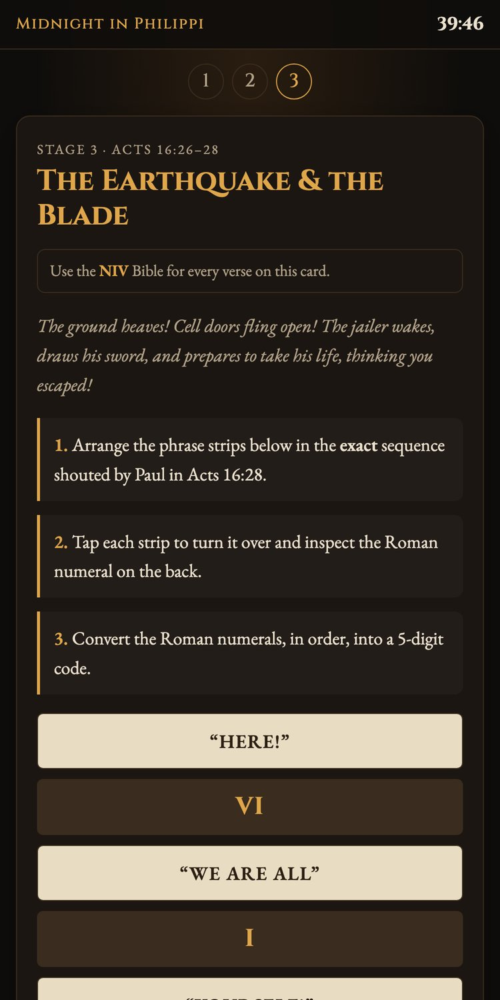
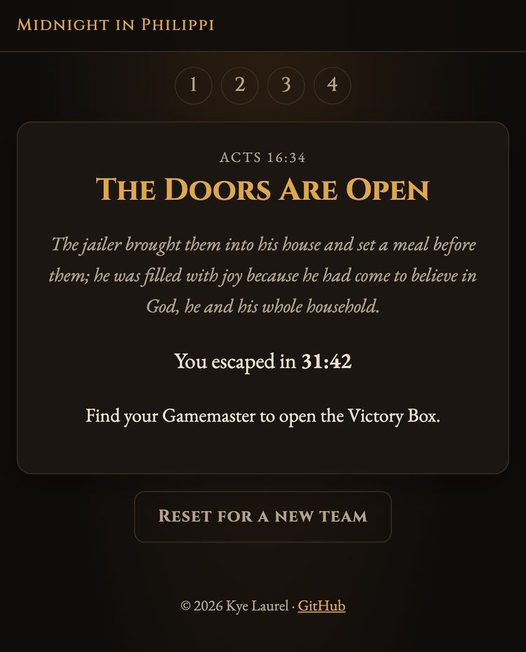

# Midnight in Philippi

A web app for *Midnight in Philippi*, a Bible escape room based on Acts 16:16–34. Teams open the site on a phone or laptop, solve each stage's clues using an NIV Bible, and enter the code to unlock the next stage.

**Live demo:** https://midnight-in-philippi.onrender.com (hosted on Render's free plan, so the first visit may take up to a minute while the server wakes up)

<table>
  <tr>
    <td></td>
    <td></td>
    <td></td>
    <td></td>
  </tr>
  <tr>
    <td align="center">Start</td>
    <td align="center">Clues and hints</td>
    <td align="center">Flip-card puzzle</td>
    <td align="center">Escape</td>
  </tr>
</table>

## Built with

- **Django 5.2** (Python): views, templates and server-side code checking
- **Vanilla CSS and JavaScript**: themed mobile-first design, CSS-only unlock animations, countdown timer
- **WhiteNoise** for static files and **Gunicorn**, deployed on **Render** from a `render.yaml` blueprint
- **Signed-cookie sessions** instead of a database, so it runs on free hosting with nothing to maintain

## Features

- Four stages and a victory screen, with a short unlock animation between each.
- Optional hints on each clue, hidden until a player taps them.
- A 40-minute countdown timer.
- Codes ignore case, spaces and dashes (`2-8-4`, `2 8 4` and `284` all work).
- Answers are checked on the server and never appear in the page source.
- No database. Each device's progress is stored in a signed cookie, so many teams can play at once.
- A reset button on the victory screen (or `/reset/`) clears a device for the next team.

## Project layout

| Path | Contents |
|---|---|
| [game/stages.py](game/stages.py) | Stage titles, answer codes and unlock animation captions |
| [game/templates/game/stages/](game/templates/game/stages/) | The clue card for each stage |
| [game/templates/game/entrance.html](game/templates/game/entrance.html) | The unlock animation scenes |

## Run locally

```sh
python3 -m venv .venv
source .venv/bin/activate
pip install -r requirements.txt
python manage.py runserver
```

Open http://127.0.0.1:8000. Run the tests with `python manage.py test`.

## Settings

| Variable | Purpose |
|---|---|
| `DJANGO_SECRET_KEY` | Required in production. It signs the progress cookies. When it is set, debug mode is off. |
| `DJANGO_ALLOWED_HOSTS` | Comma-separated domain names, e.g. `example.com`. Render's hostname is added automatically. |
| `DJANGO_DEBUG` | Set to `1` or `0` to override the default. |
